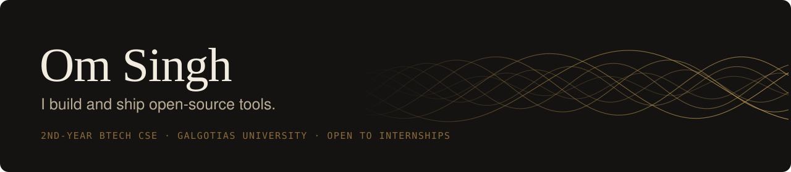

  

  <a href="https://omsingh.me">omsingh.me</a> &nbsp;·&nbsp;
  <a href="https://www.linkedin.com/in/omsingh02">LinkedIn</a> &nbsp;·&nbsp;
  <a href="https://blog.omsingh.me">Blog</a> &nbsp;·&nbsp;
  <a href="mailto:contact@omsingh.me">contact@omsingh.me</a>

Second-year BTech CSE student at Galgotias University, Greater Noida. I build and ship open-source tools that ask little of the people using them: no account, no cloud, and rules enforced where they can't be skipped.

Looking for internships. I usually reply within a day.

 

## Selected work

<table>
  <tr>
    <td width="42%" align="center" valign="middle">
      
    </td>
    <td valign="middle">
      <h3><a href="https://github.com/omsingh02/gatekeep">Gatekeep</a></h3>
      <b>Files, for exactly who you choose.</b> 
      Self-hosted file delivery. Each recipient signs in with their own email code or password, every open, download and denied attempt is logged, and you can take access back while their page is open.  
      Next.js · TypeScript · Supabase · Docker · MIT · CI and end-to-end tests  
      <a href="https://gatekeep.omsingh.me">Site</a> &nbsp;·&nbsp; <a href="https://github.com/omsingh02/gatekeep">Source</a>
    </td>
  </tr>
  <tr>
    <td width="42%" align="center" valign="middle">
      
    </td>
    <td valign="middle">
      <h3><a href="https://github.com/omsingh02/beckon">Beckon</a></h3>
      <b>Your phone, as your computer's trackpad.</b> 
      An Android app with a desktop companion for Windows, Linux and macOS, over Wi-Fi or Bluetooth. Every touch is end-to-end encrypted, you confirm a fingerprint or scan a QR code when you first pair, and there is no account and no cloud. Formerly Telepad.  
      Kotlin · Jetpack Compose · Rust · Noise protocol · MIT  
      <a href="https://beckon.omsingh.me">Get the app</a> &nbsp;·&nbsp; <a href="https://github.com/omsingh02/beckon">Source</a>
    </td>
  </tr>
  <tr>
    <td width="42%" align="center" valign="middle">
      
    </td>
    <td valign="middle">
      <h3><a href="https://github.com/omsingh02/leery">Leery</a></h3>
      <b>A bluffing card game you can't cheat at.</b> 
      Lie about your cards, call out everyone else's, and be first to empty your hand. Two to eight players on any phone, with friends or bots. The rules run in Postgres, so nobody can cheat.  
      TypeScript · React · Postgres · Realtime · MIT  
      <a href="https://leery.omsingh.me">Play it</a> &nbsp;·&nbsp; <a href="https://github.com/omsingh02/leery">Source</a>
    </td>
  </tr>
</table>

 

## More

| | |
|:--|:--|
| **[gulms](https://github.com/omsingh02/gulms)** | Your university LMS from the terminal. Syncs courses, finds lectures, and turns slide decks into Markdown and PDF study notes. Rust. |
| **[hark](https://github.com/omsingh02/hark)** | Always-on song recognition for Linux, published as an MPRIS2 player for Waybar, GNOME, KDE and playerctl. Rust. |
| **[hivectl](https://github.com/omsingh02/hivectl)** | Per-key RGB, live animations and a music visualizer for the Kreo Hive 98 on Linux, straight over hidraw. Python. [Demo](https://hivectl.vercel.app). |
| **[Reel](https://reel.omsingh.me)** | A private-first movie and TV watchlist with episode progress, stats and an MCP server. React, Supabase. |
| **[Bunny Runner](https://bunny.omsingh.me)** | A 3D endless runner for the browser. About 31 KB of its own code. Three.js. |
| **[tempmail-watcher](https://github.com/omsingh02/tempmail-watcher)** | A CLI that waits for a verification email and copies the code or link to your clipboard. |

 

  Greater Noida, India &nbsp;·&nbsp; <a href="https://omsingh.me">omsingh.me</a>

